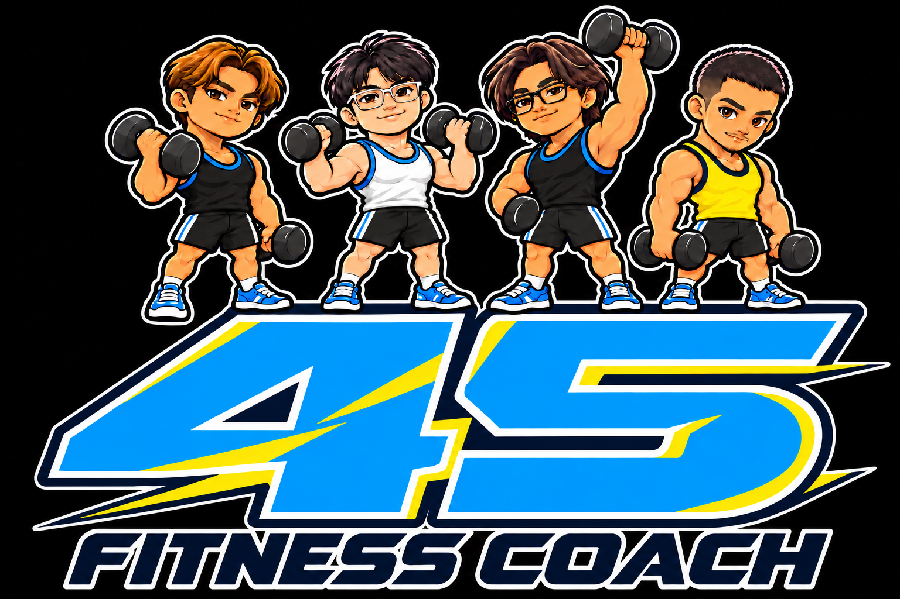

# 45 Fitness Coach

<p align="center"></p>

**A student-built fitness coaching web application that uses a camera to track exercise movements, count repetitions, and provide form feedback.**

Developed as an Electrical Engineering student project at King Mongkut’s Institute of Technology Ladkrabang (KMITL), International Program.

## Why we built it

People who exercise at home may not know whether they are performing a movement consistently. 45 Fitness Coach combines camera-based tracking, simple feedback, workout records, and game-style rewards to make practice easier to follow and more engaging.

## Features

- 15 dumbbell exercises across arms, chest, back, shoulders, and legs.
- Selected left arm, right arm, or both arms where supported.
- Joint tracking and exercise-specific rules for repetition counting and form feedback.
- Adjustable counting tolerance and voice guidance in Thai and English.
- Gold coin animations for accepted repetitions; broken red coins and sound effects for rejected attempts.
- Jumping jack and push-up activities, timers, and leaderboards.
- Saved workout sets, angle charts, movement consistency summaries, and training distribution charts.
- Workout calendars, daily completion streaks, and challenges.
- Accounts, profiles, friends, chat, and administrator tools.
- VIP membership and rewards, including the original receiving account, payment QR, and receipt-upload interface. Automatic verification requires configured external services; uploading a receipt alone does not guarantee activation.

## How it works

1. The user selects an exercise and enables their device camera.
2. The browser sends image frames to the Python server.
3. A pretrained MediaPipe pose model estimates body landmarks. Hand tracking supports experimental grip checks.
4. Python calculates joint angles and applies movement-state and alignment rules.
5. The browser displays tracking lines, counts, feedback, and coin effects.
6. Completed sets are saved for profile charts and later comparisons.

This is **pose estimation plus rule-based analysis**. The user selects the exercise; this project does not train a custom Roboflow classifier. Camera processing runs on the server, not entirely inside the browser.

## Technology

Python, Flask, MediaPipe, OpenCV, NumPy, HTML, CSS, JavaScript, SQLite, and Waitress. Windows PowerShell scripts help install and launch the application.

## Run locally on Windows

Install 64-bit Python 3.11, download this repository, and extract it. Open PowerShell inside the folder containing `app.py`:

```powershell
py -3.11 -m venv .venv
.\.venv\Scripts\python.exe -m pip install -r requirements.txt
.\.venv\Scripts\python.exe serve.py
```

Open **http://127.0.0.1:5000/45-fitness-coach** on the same computer. Keep PowerShell running; use Ctrl+C to stop.

The `START-HERE.cmd` launcher is also provided. It uses a separate environment in the parent folder. Use one startup method at a time.

### Sharing on phones

A GitHub repository is a source-code/project page, not a running Flask server. Remote users need a reachable server and HTTPS for camera access. A localhost link only opens the user's own computer. Hosting and email delivery require separate configuration.

## Accounts and optional services

Create accounts through the app. To grant administrator access locally, run:

```powershell
.\.venv\Scripts\python.exe manage_admin.py --email "your-existing-account@example.com"
```

Email password reset requires SMTP configuration. The original public receiving account and payment QR are included at the project owner’s request. SMTP passwords and user databases are not included. Never upload runtime `data/`, local service configuration, receipt uploads, or credentials to GitHub.

## Understanding the charts

Angle summaries describe movement patterns and consistency. Compare the same exercise, side, and measurement source. A lower average angle does not automatically mean better form. These charts do not measure muscle mass, muscle growth, or strength.

Cardio energy figures are estimates where supported and depend on entered weight, selected activity intensity, and tracked activity duration. They are not direct measurements of calories or health.

## Limitations and testing

Lighting, occlusion, camera angle, device performance, and network speed affect tracking. Grip checks are experimental; hidden fingers cannot be reliably assessed. Front and side views are supported where sufficient landmarks are visible, but performance is not guaranteed for every view.

The bundled `TEST_REPORT_V24.txt` records earlier automated and simulated tests. Simulated camera restart tests do not prove 200 successful openings on every real phone or webcam. The app is based on the supplied v24 archive, preserving its features, payment QR and receiving account. The camera network loop now applies timeouts to both response headers and response bodies, including status recovery requests. Packaging adds this README and .gitignore, makes the launcher use its own folder, removes automatic administrator assignment from updates, and prompts for an existing administrator email in Setup-Admin.ps1. It has not been fully retested on physical devices.

This is an educational prototype, not a medical assessment or a substitute for professional exercise instruction.

## Future work

- Improve form checks with more real-device and varied-view testing.
- Improve performance and provide permanent HTTPS hosting.
- Research visual estimates of muscle regions and body composition using validated reference measurements. These are future research goals, not current capabilities.

## Credits

See `ATTRIBUTION.txt` for exercise-image sources and supplied assets. Public visibility does not grant a general open-source license; third-party assets retain their respective terms.
