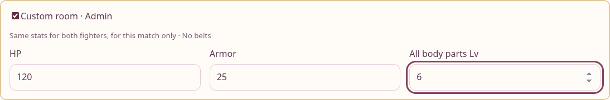
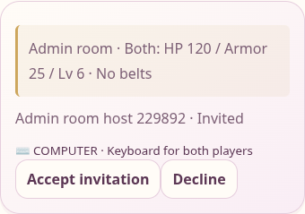
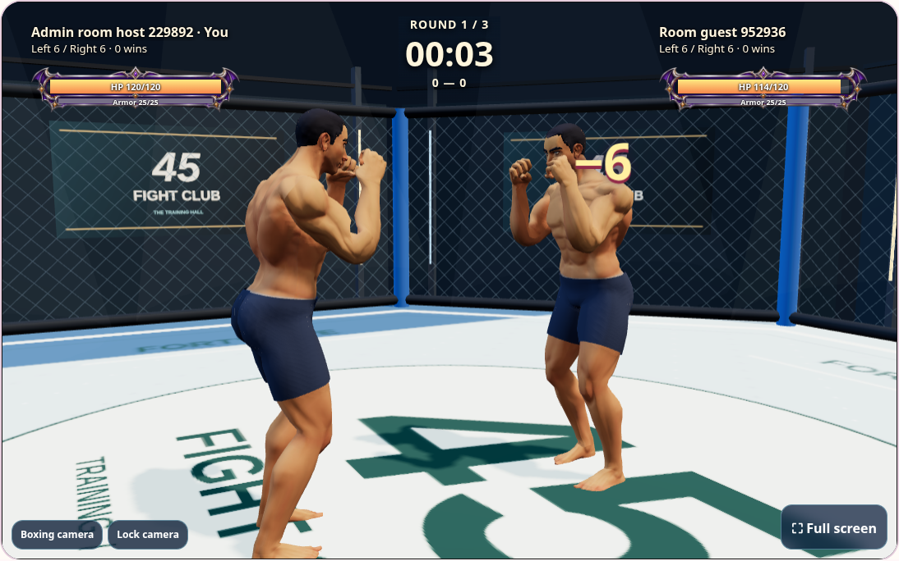

# Player HP and custom admin rooms

Players start new standard matches with 50 HP plus their existing training bonus.
For example, 30 saved bag punches now give 54 HP. No workout, EXP, profile or training
ledger is rewritten. Existing matches retain their snapshots. Easy bots remain at
20 HP and Hard bots at 50 HP.

Admins can open Friends, select controls, enable **Custom room · Admin**, and choose
HP (1–10,000), armor (0–1,000), and all body parts Lv (1–100) before inviting an
accepted friend. Both fighters receive those settings for that match. The guest
sees the settings before accepting. HP and armor restore to the selected maximum
between rounds; armor recovery respects its custom ceiling. Body levels affect
match damage and muscle appearance, while saved progression remains unchanged.
Custom matches do not award competitive belts. Standard friend invitations remain
available to everyone.

The server checks the persisted admin role, validates every value, and freezes
settings at invitation time. Hiding the controls is not the permission check.

Friend combat previews keyboard movement locally for up to 180 ms, bounded to
19 cm and respecting cage limits, opponent separation, kicks and hit reactions.
Remote movement bridges up to 250 ms between snapshots. Redundant heartbeat requests
are skipped while gameplay controls are pending. Hits and results still come from
the server; high latency can still delay confirmed damage.

Validation: Python combat/progression and admin permission/range/reset/persistence
checks; Node keyboard, camera pose and playback suites; Chromium auto training,
ordinary friends/parry and custom two-account room scenarios, including 400 ms
reply delays and mobile guest layout. Browser accounts use a disposable local DB.
Deployment verification uses exact revision/assets and read-only public fixtures.

