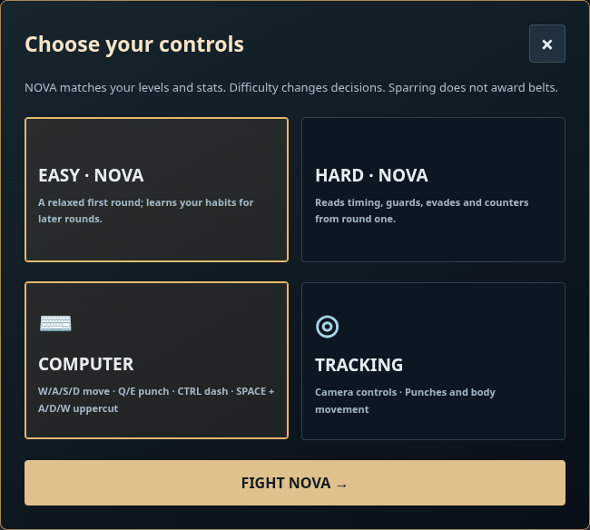
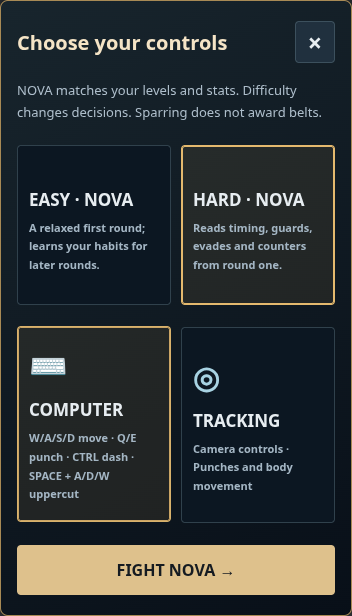
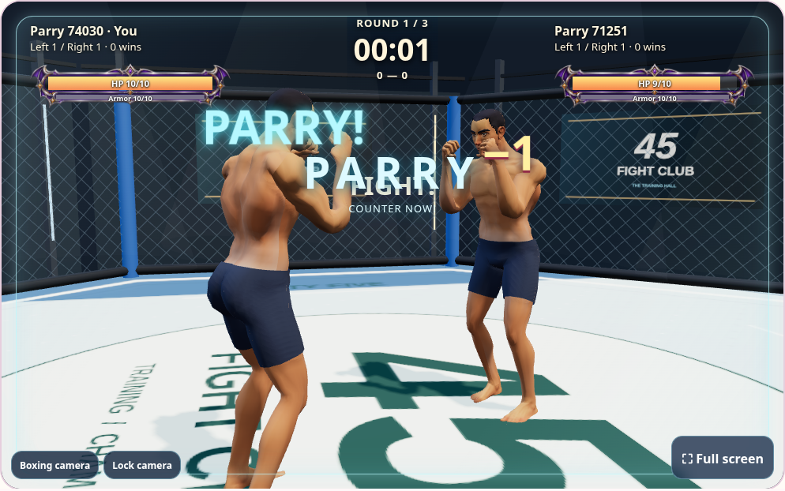

# NOVA sparring, hit reactions and dash parry

The Bot tile now opens a complete private best-of-three match against NOVA. Choose
Easy or Hard and keyboard or camera controls. Matches support countdown, ten-second
knockdowns, round recovery, results, rematch, leaving and returning after navigation.

NOVA copies the selected fighter's left/right arm damage, leg damage, HP, armor,
growth levels and body dimensions. Only its appearance and decisions differ.
Easy starts with relaxed attacks and learns hand preference and ducking from the
previous round. Adaptation stays capped. Hard uses delayed visible observations,
spacing, anticipation, guard selection, evasions and recovery openings immediately.
Memory belongs to the current match; it is not a trained model or cross-account
profile. Both difficulties use the same server combat and cooldown rules. Sparring
does not add competitive belts; friend-match rewards are preserved.

New matches use rules 7. Landed damaging hits push the target 0.14 cage units
(0.18 for uppercuts), with cage-boundary clamping and a short torso reaction.
Blocks and misses do not push. Older active rooms retain their original rules.

In keyboard rooms, dash right against an incoming left straight/hook, or left
against a right straight/hook, at contact. A successful Parry spends no HP and
opens a 0.65-second, single-use counterpunch window that bypasses recovery. The
counter resolves after 0.10 seconds. The server checks side, timing, range and
reuse; client flags cannot grant a counter. Uppercuts and kicks cannot grant
Parry. Camera controls still use body slips and ducks, with no keyboard dash.

A thin glass frame and PARRY / COUNTER NOW cue identify the opportunity. The
counter may be pressed while Ctrl is still held. Reduced-motion mode uses a
static cue. Timing is server-authoritative, so network latency affects the
available reaction time.

## Verification

- 73 Python boxing tests: existing rooms, guards, matched stats, private bot rooms,
  learned round changes, delayed bot decisions, counter expiry/reuse, forged input,
  knockback and cage limits.
- Keyboard and pose Node suites, including one-use counter grants and unchanged
  camera punch mapping / one-second movement holds.
- Chromium: complete Easy match, result and rematch; Hard bot; desktop/mobile
  difficulty selection; navigation resume; camera calibration and tracked hook
  against an animated bot; genuine two-account Ctrl+D parry and Q counter.
- Existing friend/lobby browser regression: directional guards, kicks, movement,
  key settings, camera lock and navigation.
- Installer preservation checks and exact deployed revision / static-asset smoke.

All account-writing browser tests use disposable local databases. Live verification
uses GET requests and public-asset fixtures without creating production accounts.

