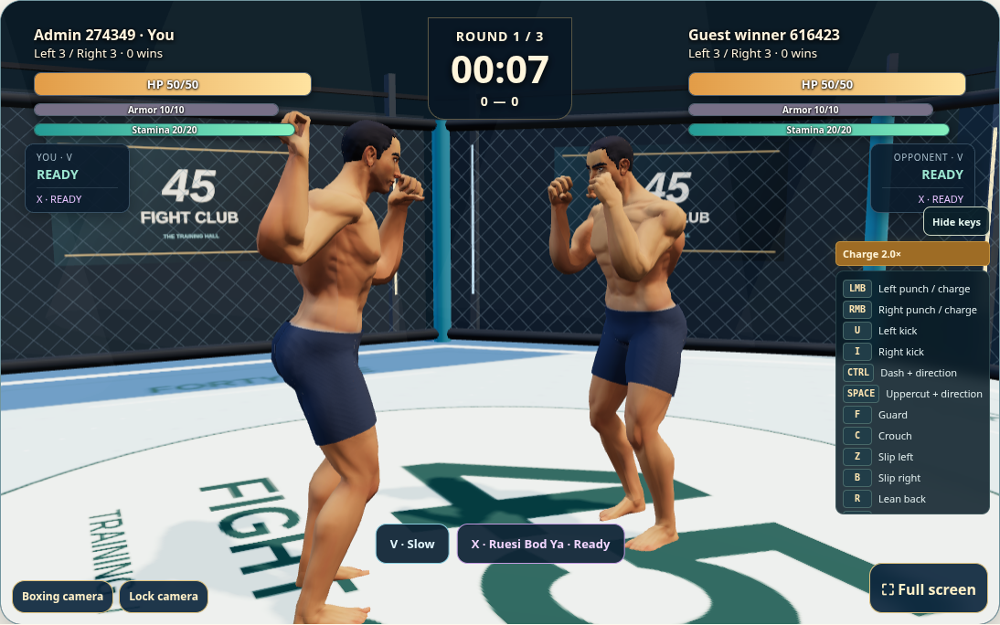
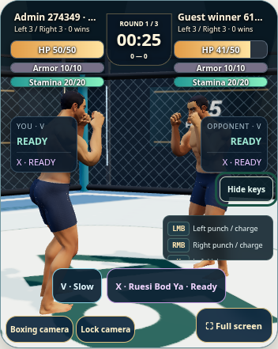
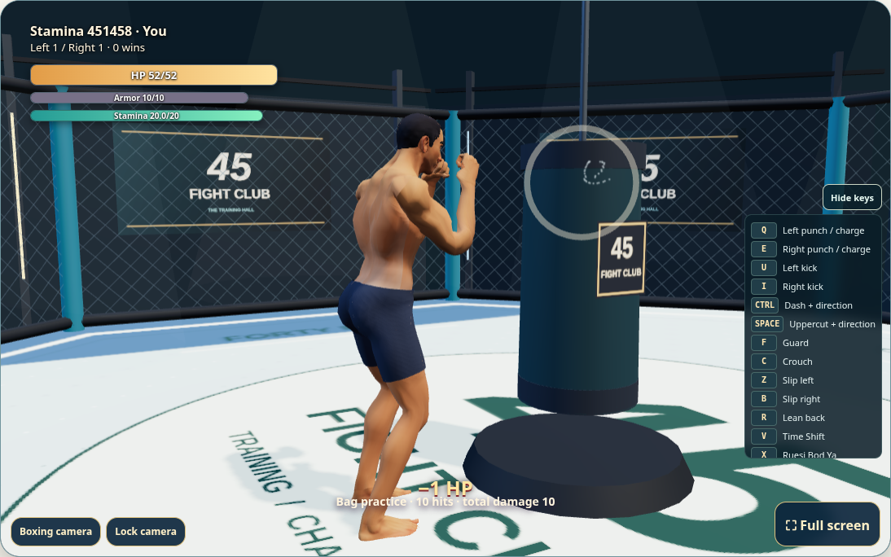
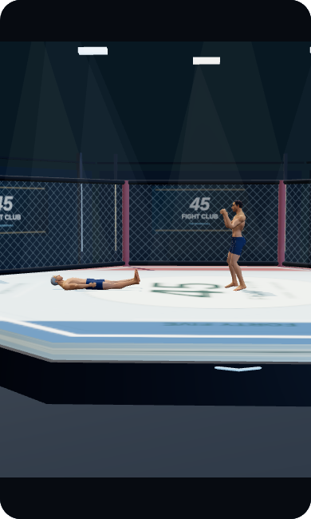

# Charged punches, stamina and hit feedback

Updated 2026-11-03. Changes extend the existing Quaternius boxing game.

- Normal computer punches begin winding up on press and strike on release. Charging starts increasing damage after 0.2 combat seconds, reaches 2× at 1.5 seconds, and costs the same 2 stamina. The server measures the hold; supplied client multipliers cannot change damage. Guard, focus loss, hit stun and X cancel the hold.
- Left/right punch settings accept LMB/RMB. Mouse punches are scoped to the arena canvas; right-click suppression is limited to mapped arena input. Saved unique key bindings remain intact.
- New matches use rule 10: stamina 20, normal/hook/uppercut punches cost 2, including misses and matching-punch Counters. Kicks and X retain their existing costs. Regenerate 5 per real second while guarding or after 0.65 seconds without a punch. Cinematics and round breaks pause regeneration; a new round restores 20.
- An unblocked hit pushes the recipient back, recoils head/chest, interrupts an unlanded strike and prevents attacks for 0.48 combat seconds. Guard and dash remain available. Guard spends armor first, with overflow reaching HP. Simultaneous matching-punch Counter still deals 0 to both fighters.
- Landed hits use native 3D particles and a shock ring. Charged hits have a larger burst. Normal deciding-hit cinematics launch the opponent into a slow fall with matching final server positions; lethal X transitions into a slower launched fall bounded by the cage.
- HP, armor and stamina share a compact hierarchy. The edge guide reflects live bindings, includes dash and excludes movement rows. One persisted toggle hides/shows the guide and charge meter. Short screens scroll the guide above skill buttons. Fullscreen provides more room.
- V remains 60 seconds / 120-second cooldown. X remains one right-arm damage / 180-second cooldown. Reduced-motion and effects-off settings suppress impact particles and launch motion.

## Visual review

Used the Product Design audit workflow with actual browser captures. Inspection found and resolved hidden charge feedback, mobile guide overlap, a renderer override that hid the wind-up, and cropped mobile KO framing. No Figma document was supplied or modified.

## Validation

- Python boxing regression suite: 131 tests passed; the subsequently added new-round stamina/reset test also passed (132 total tests now present).
- Node: computer controls, tracking pose and playback/training suites passed, including charge cancellation, mouse remapping, stamina exhaustion and guard/dash during stun.
- Two Chromium clients: remap actual settings, hold/release ×2 damage synchronized to both clients, tap damage, guard cancellation, stamina meters, native hit events, hint persistence, mobile/fullscreen and reduced-motion cleanup.
- Two-client Counter/V regression: zero HP/armor loss, 60-second duration, 120-second cooldown, both HUDs and reduced-motion clock feedback.
- Practice: repeated punches exhaust stamina, guard/rest replenish it, native particles render, re-entering practice restores stamina, no browser errors.
- Finale fixture: head contact, desktop/mobile framing, bounded lethal-X launch, reduced-motion fall and resource cleanup.
- Installer tests, application-file hashes and changed JavaScript syntax checks passed. Browser tests used disposable local accounts/databases; live verification uses public assets/read-only fixtures.

Existing active matches retain their prior stamina/guard rules. Start a new match to use rule 10. Local browser checks use Chromium software WebGL; physical-device graphics performance and real internet peer latency were not benchmarked.
