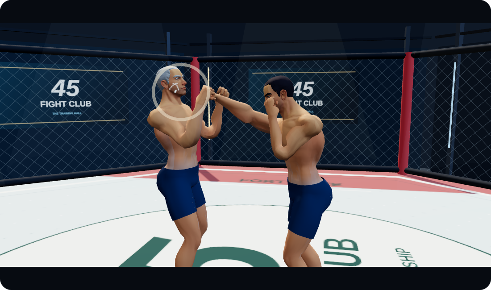
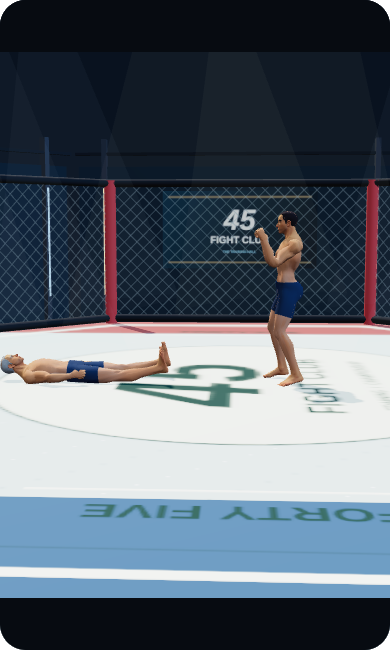
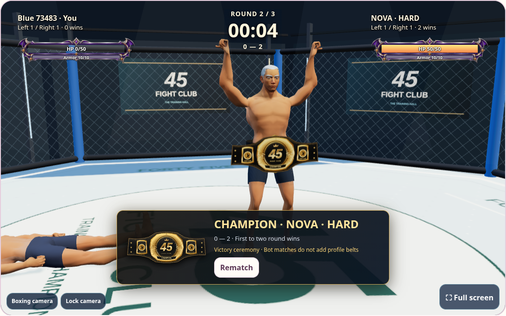

# Deciding-hit cinematic and victory ceremony

A server-confirmed hit that wins the second round starts a six-second finishing
sequence in friend/custom and bot matches. The winner delivers a stylized finishing
punch in slow motion, the camera closes in, a light impact ring and sweat particles
mark contact, and the defeated fighter falls onto the canvas. The original avatar
stays intact. This is presentation only: it cannot deal additional damage, trigger
another strike or award another victory.

Both clients use the same server timestamp. Delayed views join the current phase;
returning after the sequence does not replay it. Ordinary round knockdowns keep
their ten-second recovery. During the finale, combat input cannot change the
outcome; leaving or disconnecting preserves the already confirmed winner.

At the end, the winner receives the existing 3D belt and victory pose in every
opponent mode, including when the bot wins. The bot result explicitly explains
that its ceremony does not add profile belts. The reward ledger still accepts only
friend matches, including admin custom rooms, with one belt per match.

The camera frames both fighters on desktop and mobile, including the fall. Reduced
motion or disabled effects removes the cinematic camera, particles and punch beat.
Scene reset/rematch/leave disposes the temporary effect geometry and materials.

Validation: backend tests cover final-hit eligibility, six-second real-time ordering
under V, no extra attacks, winner preservation on exit, ordinary recovery and
friend-only/idempotent rewards. Local browser tests cover both friend viewpoints,
mobile and reduced motion, easy-bot player wins, hard-bot wins, 3D belt ceremonies,
rematches, and cleanup. A fixed-time public scene checks contact, full-body framing
and late-view behavior; production smoke uses read-only public assets and fixtures.

