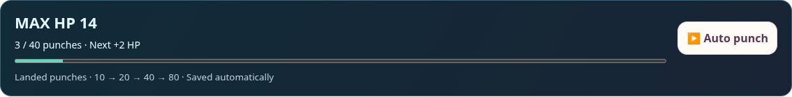
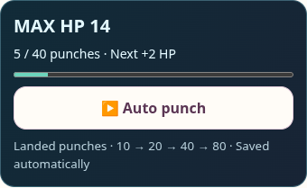
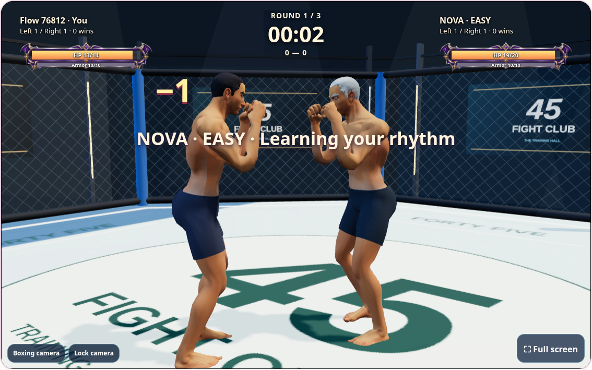

# Smooth combat and bag-training HP

Friend and bot matches now update the local pose directly from input, independently
of pending network requests. Remote strikes retain their wind-up instead of starting
halfway through a punch. Guard snapshots blend into recovery instead of cutting off
the striking arm. A small position interpolation buffer bridges snapshots,
with bounded extrapolation that stops on stale data, a hit or stopped movement.
HP/guard DOM is rebuilt only when the displayed values change. Contact sweeps reject
clear misses early while preserving point-capsule collisions and arm lengths.
Server damage, cooldowns, parries and positions remain authoritative.

Training has a visible Auto punch / Stop auto punch button and a saved HP progress
bar. Auto alternates punches at the bag; it can approach the bag if needed. It stops
when leaving training, changing pages or hiding the tab, and never resumes itself.
Only landed punches count toward HP; kicks and misses do not. Keyboard and camera
practice can both use auto training. It adds game HP, not workout EXP or currency.

| HP after upgrade | Punches needed for this upgrade | Cumulative punches |
| --- | ---: | ---: |
| 12 | 10 | 10 |
| 14 | 20 | 30 |
| 16 | 40 | 70 |
| 18 | 80 | 150 |

The cost doubles at every level; each level adds two max HP. Progress belongs to the
selected profile and persists across reloads. New matches snapshot the player's
trained HP, and each round restores that maximum. Training does not heal or alter a
match already in progress. Existing rooms retain their saved values.

NOVA Easy has **20 HP** and Hard has **50 HP**, including round recovery. Bot arm and
leg damage still follow the player's levels; its HP no longer copies the player.

Training uses owned-profile endpoints, bounded batches, idempotent sequences and a
shared per-account pace budget. Restarting a session cannot reset that budget or
credit the same event twice. Idle sessions renew before another punch. Saves are
flushed on navigation; small hit requests use keepalive during page exit. Confirmed
progress is shown by the bar. Connection failures offer a reconnect button.

## Validation

- 82 Python boxing/progression tests, including exact 10/20/40 boundaries, ownership,
  duplicate responses, burst limits, session expiry, HP snapshots and 20/50 bot HP.
- Node keyboard/pose suites plus interpolation, stale snapshots, bounded prediction,
  training retries, idle renewal, final-save flush and full punch extension through
  incoming guard snapshots.
- Chromium: actual auto punches through HP 12 and 14, reload persistence, mobile
  progress UI, navigation stop/resume, HP in friend/bot matches and 20/50 bot values.
  Camera-mode auto also works without a camera; a pending hit survives reload.
- Simulated 400 ms replies: local strike starts within 150 ms, local crouch updates
  while requests are pending, and remote wind-up begins within its first 45 ms.
- Existing contact, camera, friend-match and parry regressions; no account writes on
  production. Exact revision/assets and public scene are verified after deployment.

Network latency still affects authoritative hit outcomes; rendering does not change
combat results or guarantee a particular frame rate on every device.

