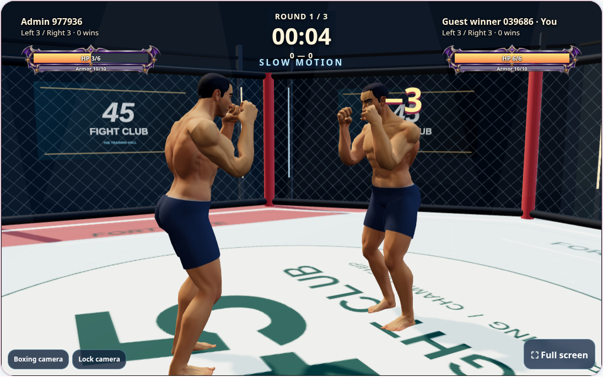
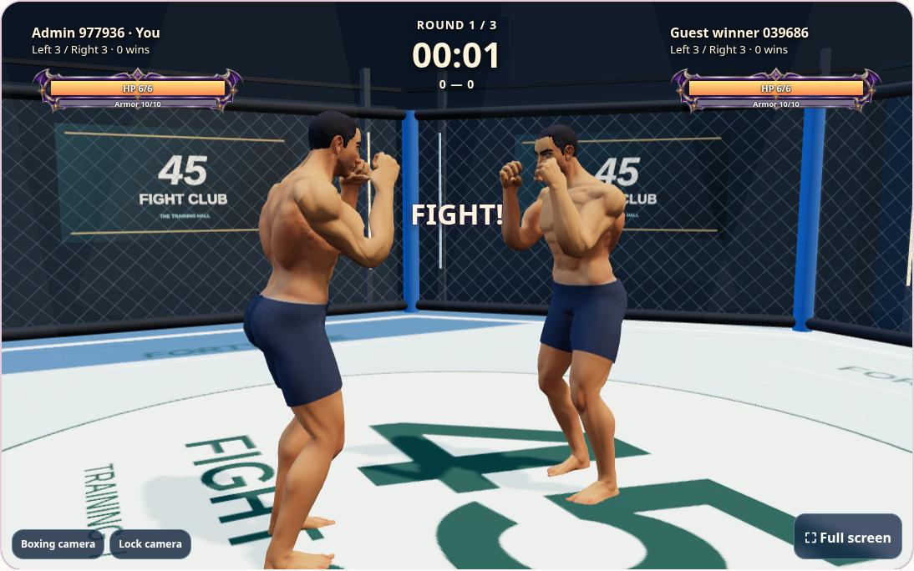

# Winner belts, shared slow motion and rematches

Custom admin rooms now award the winner one championship belt, just like normal
friend matches. Opening an owned profile reconciles earlier finished victories
against the belt ledger, including old custom rooms; the match ID prevents duplicate
rewards. Bot sparring remains excluded. Invitations and room summaries reflect the
new reward rule.

V activates slow motion for both fighters for 60 real seconds. Combat runs at 40%
speed: movement, attacks, impact timing, guards, parries, recovery, bot decisions
and combat animation use a shared game-time scale. Each player's skill cooldown is
180 real seconds from activation. Skills cannot stack or refresh an active effect.
Disconnect detection and room expiry remain in real time. A visible skill button,
countdown and blue arena effect expose the state to both players. Tracking players
can also use V or the button; saved keyboard remaps survive the new binding.

After a friend match, either player can request another match on the result card.
The other accepts from their result card; a pending request can be cancelled.
Once both agree, the server creates one new match with the same opponents, controls
and match stats. HP, armor, scores, readiness and skill cooldown reset. Both clients
follow the new match automatically and start the normal ready/countdown flow.
No new friend invitation is required. Original results and belts remain intact.

A control packet arriving at a knockout now acknowledges the resulting round state
instead of losing the transition when the action becomes invalid. An occasional
fallback heartbeat also recovers legacy rooms from stale/failed control replies.

Validation covers exact duration/cooldown boundaries, both-player movement and delayed
impact, real-time disconnects, knockout persistence, rematch consent/cancellation,
conflicting active rooms, custom stats and one belt per match. Browser scenarios use
disposable local accounts; production verification reads exact revision/assets and
renders public fixtures without creating production test accounts.

Existing rule-8 rooms retain their combat timing; use a rematch/new match for V.
Network latency can still delay confirmed hits. Match stats stay fixed for rematches.

## Dodge counter window

A successful lean/duck dodge or dash parry against a punch slows only the attacker
for up to five real seconds. Without a counter, it expires automatically. The
defender's next accepted punch immediately removes that dodge slow and can counter
without waiting for punch recovery. Misses and kicks do not grant this effect.
Each fighter has an independent animation clock, so the defender stays responsive.
The separate V skill keeps its own duration; a counter removes only the dodge effect.
A unit regression covers movement asymmetry, expiry and immediate cancellation;
a browser regression checks real X/Q inputs and both fighters' animation rates.
