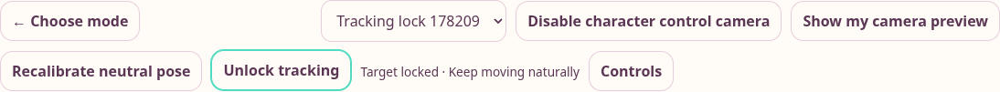

# Manual target lock across camera views

Once a body is detected, **Lock tracking** keeps the current target selected while
its live pose moves. **Unlock tracking** restores automatic selection. The control
appears in the shared workout camera, cardio camera and boxing tracking controls.
The live workout avatar uses the same camera selection. Two-player workouts can
lock each slot independently. Stopping and starting a new camera session resets the
lock; changing the lock does not reset the current set, calibration or repetitions.

Workout and cardio locks use the server's existing geometric person association.
Pinned targets add bounded torso-motion prediction and do not auto-switch to a
stable person elsewhere after losing the original target. Boxing uses an on-device
geometric selector before its existing pose controller. Candidate order can change
without selecting a different person. Missing or overlapping observations produce
no selected pose, so counting/actions pause instead of replaying cached landmarks.

The lock follows fresh joint positions; it does not freeze the skeleton or lower
exercise form thresholds. It cannot recover joints the camera cannot see or prove a
person's identity. Unlock/reselect when changing players or after ambiguous overlap.

Validation includes moving/reordered candidates, nearby recovery, missing/overlapping
poses, distant replacement rejection, independent two-player locks, session isolation,
unchanged nonzero repetition counts, cardio support and lock reset on a new session.
Browser fixtures exercise all three camera interfaces and do not create production
accounts or workout records.

