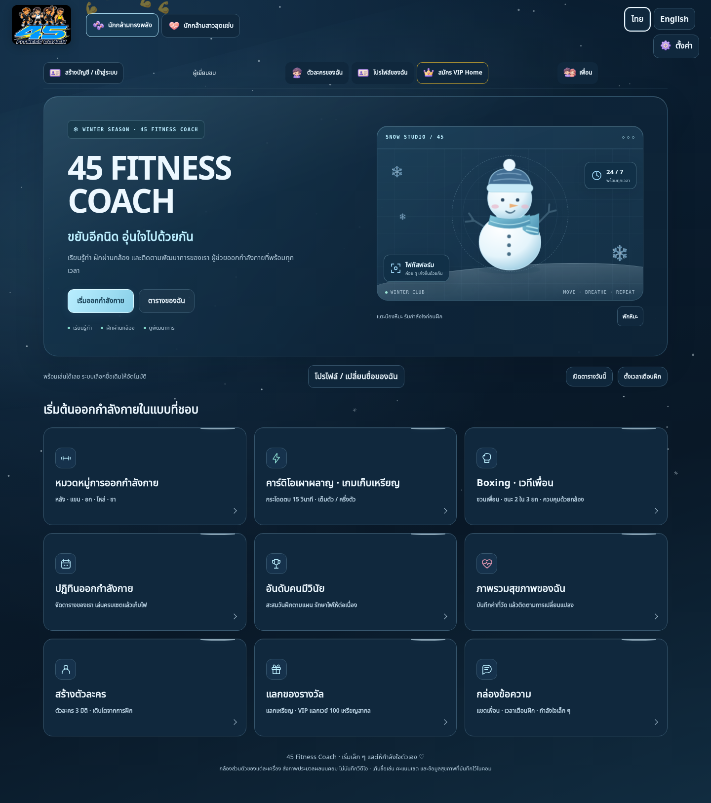
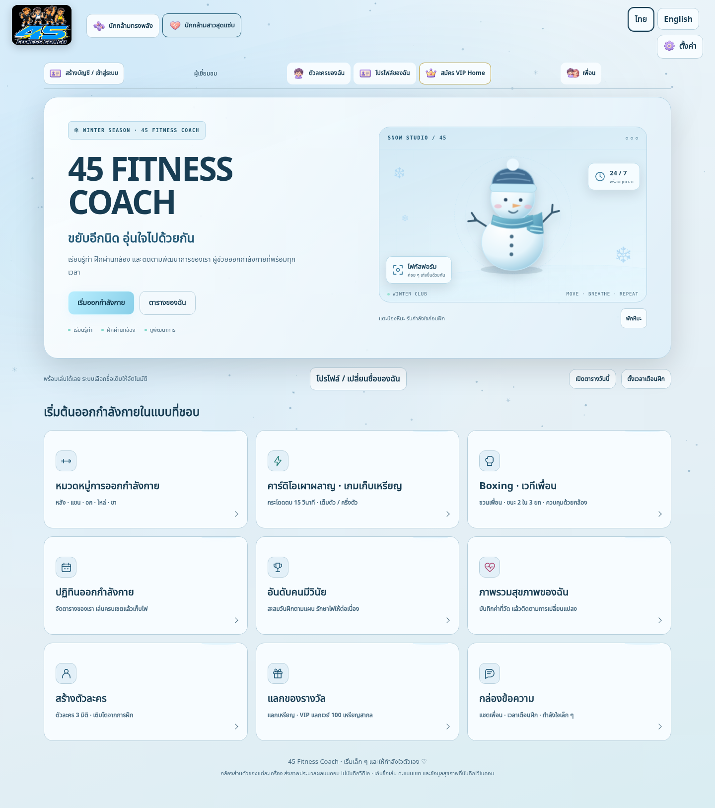

# Snow Studio homepage

Replaces the Loy Krathong homepage with frosted winter UI, native line icons, a friendly animated SVG snowman, and wind-driven canvas snowfall. Training, calendar, profile, health, rewards and boxing entry points remain the existing controls. No account schema, workout history or game rules change.

Snow uses one canvas with at most 88 particles (42 on narrow screens), capped pixel density and a single RAF loop. It pauses off-home, on a hidden document, with the snow toggle, with effects disabled, or when reduced motion is requested. The mascot separately pauses offscreen. Preferences are stored only in the current browser.

See [design QA](design-qa.md) and [browser results](qa-results.json). The checked screenshots include both palettes and 320/390/1440 px layouts. The user requested code-native UI rather than decorative image panels; instructional exercise photos remain in the exercise choices.

